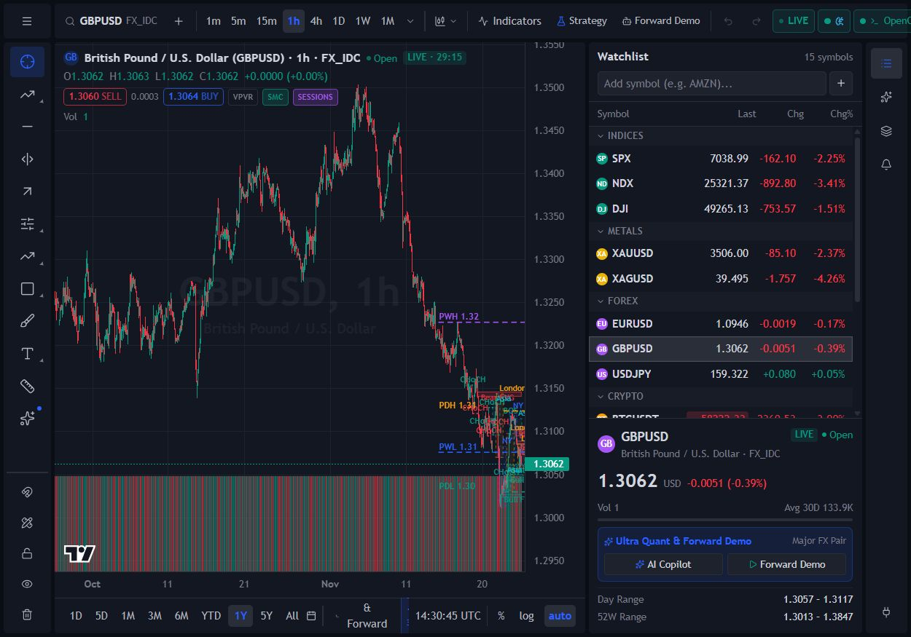

# TradingView is over.

> **Why pay for TradingView when you have a more advanced free alternative?**

> **PUBLIC BETA** — This is the beta build. The **full-fledged version drops when this repo hits 10K stars**. Star it, watch it, and you will get the complete release first.

An independent, open-source charting and AI analytics terminal with a production-grade drawing engine. Built from the ground up to make the Long/Short Position tools behave the way traders actually expect: precise brackets, real position sizing, TradingView-style stats, and drawings that survive a refresh.




---

## Why this exists

The original drawing layer looked the part but fell apart in use: positions were two-anchor hacks, stop loss was hard-coded to half the target distance, dragging levels silently corrupted the math, and every refresh wiped the chart clean.

This beta rebuilds that layer as a real engine. The reverse-engineering breakdown — evidence ledger, observations vs. inferences, unknowns, and gap-to-fix mapping — lives in [`docs/DRAWING_ENGINE_REA.md`](docs/DRAWING_ENGINE_REA.md).

## What works in the beta

### Long / Short Position (the main event)

- **True 3-anchor model:** entry, target, stop. Legacy 2-anchor drawings migrate automatically.
- **Real position sizing:** account size, lot size, risk % or fixed amount, leverage, point value, qty precision.
- **TradingView-style formulas:** risk-based qty, leverage cap, price offsets, ticks, P&L, account balance after TP/SL.
- **TV-style stats tags:** offset, percent, ticks, Amount, P&L, Qty, Closed/Open P&L and Risk/Reward Ratio.
- **Four handles:** entry, target, stop and duration. Body drag moves the whole bracket.
- **Clamped geometry:** TP/SL stay on the correct side of entry with a minimum tick gap; no negative R:R, no inverted zones.
- **Off-screen safe:** a level outside the visible range no longer makes the entire position disappear.
- **Independent styling:** separate target and stop colors, fill opacity, border, price labels, compact stats, always-show stats.

### Other drawing tools

- 16 px transparent hit corridors on thin lines and outlines so shapes are actually grabbable.
- Independent border color/style/width, fill controls, text formatting, templates and pre-draw defaults.
- Anchor and box handles, magnet snapping, undo/redo, visibility filters.
- Indicators modal shows active indicators with per-indicator and remove-all controls.
- Auto-scale button clears the price-to-bar lock so the price axis never stays frozen.

### Platform

- Persistence: versioned, validated, debounced `localStorage` envelope with migration.
- Error boundary around the drawing overlay: one broken drawing cannot kill the chart.
- TradingView-speed candle formation: new bars snap in instantly, live ticks settle in ~90 ms with quintic ease-out.
- Live market data, watchlists, indicators, overlays, AI panel, strategy tester and paper trading shell.

## Quick start

```bash
npm install
npm run dev
```

Open `http://localhost:5173`.

API runs on `127.0.0.1:3001` by default (`npm run dev:api`).

To run the checks:

```bash
npm run typecheck
npm test -- --run
npm run build
```

## Repo layout

| Path | What it is |
|---|---|
| `src/lib/drawingPosition.ts` | Pure position geometry + sizing + simulation engine |
| `src/components/drawings/PositionShape.tsx` | Position renderer and handles |
| `src/components/drawings/DrawingOverlay.tsx` | Full drawing overlay / interaction layer |
| `src/components/drawings/DrawingSettingsModal.tsx` | Style / Inputs / coordinates / visibility / templates |
| `src/state/workspaceStore.ts` | State, undo/redo, persistence and migration |
| `tests/unit/drawingPosition.test.ts` | 22 pure engine tests |
| `tests/unit/drawingPersistence.test.ts` | Persistence + synchronization tests |
| `docs/DRAWING_ENGINE_REA.md` | REA reverse-engineering breakdown |

## Roadmap to the full-fledged release

Unlocked at **10K stars**:

- Automated Playwright drag/handle E2E suite
- Server-side drawing sync across devices
- Price-axis labels instead of in-plot chips
- CI, ESLint, Prettier
- Code-splitting the 977 kB bundle

## Disclaimer

This is an independent educational/experimental project and is **not affiliated with, endorsed by, or connected to TradingView**. TradingView is a trademark of its respective owner. The phrase "TradingView is over" is opinion/marketing copy, not a claim of ownership or affiliation. Market data is for demonstration purposes and is not financial advice.

## License

[MIT](LICENSE)
