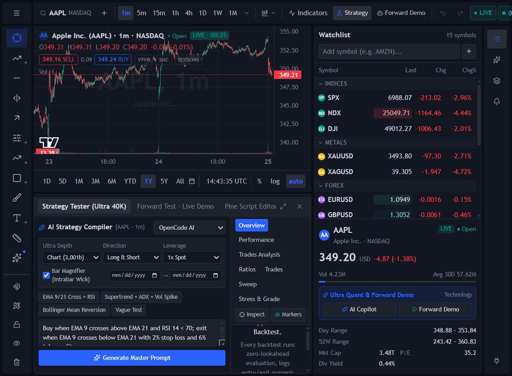

# TradingView is over.

> **Why pay for TradingView when you have a more advanced free alternative?**

> **PUBLIC BETA** — This is the beta build. The **full-fledged version drops when this repo hits 10K stars**. Star it, watch it, and you will get the complete release first.

**This is not just a chart. It is an AI-first trading terminal.** You describe a strategy in plain English, the AI strategy compiler turns it into a Master Prompt, the backtester runs it zero-lookahead with full trade-by-trade traces, and the Forward Demo walks it through live market data with zero real money at risk. The chart is the canvas — **the AI is the product.**




---

## The full vision — why this is different

Most charting tools give you candles and a wish. This one gives you an AI copilot that actually sits inside the workflow:

- **OpenCode AI + DeepSeek / BYOK** are first-class citizens, not a bolted-on chat box.
- **Structure Brief, Auto S/R, SMC Zones, Vol Profile, Auto Fit and Market Scan** are one click away.
- Ask the AI to **scan the market**, then get a structured, readable breakdown of structure, momentum, the latest candle and volume — right on the chart.
- The **AI Range** tool sends a selected chart range straight to the copilot for context-aware analysis.

## AI integration is the main event

The right panel is a full **AI Strategy & Forward Copilot**:

- Multiple providers: **OpenCode**, **DeepSeek V4.1 Flash Free**, and your own key (BYOK).
- **Structure Brief** summarizes the market in seconds.
- **Auto S/R** and **SMC Zones** annotate levels automatically.
- **Market Scan** reads the symbol and timeframe you are looking at and returns a disciplined table of metrics.
- **Ask DeepSeek / AI** lets you critique a backtest, ask *why* a trade was taken, and refine the Master Prompt without leaving the terminal.
- The copilot knows the chart state — symbol, timeframe, visible range and drawn levels — so answers are grounded in what you are actually analyzing.

## Backtesting that actually tells you the truth

The built-in **Strategy Tester (Ultra 40K)** is designed for traders who hate black boxes:

- **AI Strategy Compiler:** write the strategy in plain language, generate a precise Master Prompt.
- **Zero-lookahead evaluation:** no cheating, no repainting, no hindsight.
- **Full numeric rule traces** on every trade — inspect entry, exit and the exact conditions that fired.
- **"Why? / Critique"** explains each decision in human language.
- Overview, Performance, Trades Analysis, Ratios, Trades, Sweep, Stress & Grade — everything serious backtesting needs, in one drawer.
- Presets like **EMA 9/21 Cross + RSI**, **Supertrend + ADX + Vol Spike**, and **Bollinger Mean Reversion** are ready to audit or rewrite.

## AI Forward Testing — trade the future, risk nothing

The **Forward Demo** is where the beta gets genuinely unfair:

- Run the approved strategy on **live demo forward data** with simulated execution.
- No capital at risk, no execution anxiety — just clean evidence of how the rules behave out of sample.
- Combine it with the paper-account shell and you have a complete research-to-execution loop without leaving the app.

## The chart is world-class too (yes, including drawings)

We rebuilt the drawing engine from the ground up so the canvas never undersells the AI:

- **True 3-anchor Long/Short Position:** entry, target and stop; legacy drawings migrate automatically.
- TradingView formulas for risk, leverage, lot size, point value, qty precision, P&L and R:R.
- TV-style stat tags: offset, percent, ticks, account Amount, Closed/Open P&L, Qty and Risk/Reward Ratio.
- Four handles, body drag, clamped levels, off-screen safe rendering and persistent drawings.
- 16 px hit corridors, independent borders, templates, magnet snapping, undo/redo.
- TradingView-speed candle formation: new bars snap in, live ticks settle in ~90 ms with smooth quintic easing.
- Price axis auto-unfreezes, and active indicators can be removed directly from the modal.

## Public beta → full-fledged release

This is the beta. The **full-fledged build** unlocks at **10K stars** and goes deeper into AI-driven strategy generation, automated forward-test reporting, cloud sync and a fully code-split production bundle. The foundation is already live — this is the early-access layer for people who want in before it becomes the default.

## Quick start

```bash
npm install
npm run dev
```

Open `http://localhost:5173`.

API runs on `127.0.0.1:3001` by default (`npm run dev:api`).

To run the checks:

```bash
npm run typecheck
npm test -- --run
npm run build
```

## Repo layout

| Path | What it is |
|---|---|
| `src/lib/drawingPosition.ts` | Pure position geometry + sizing + simulation engine |
| `src/components/drawings/PositionShape.tsx` | Position renderer and handles |
| `src/components/drawings/DrawingOverlay.tsx` | Full drawing overlay / interaction layer |
| `src/components/drawings/DrawingSettingsModal.tsx` | Style / Inputs / coordinates / visibility / templates |
| `src/state/workspaceStore.ts` | State, undo/redo, persistence and migration |
| `tests/unit/drawingPosition.test.ts` | 22 pure engine tests |
| `tests/unit/drawingPersistence.test.ts` | Persistence + synchronization tests |
| `docs/DRAWING_ENGINE_REA.md` | REA reverse-engineering breakdown |

## Roadmap to the full-fledged release

Unlocked at **10K stars**:

- Automated Playwright drag/handle E2E suite
- Server-side drawing and strategy sync across devices
- Deeper AI strategy generation and automated forward-test reports
- Price-axis labels instead of in-plot chips
- CI, ESLint, Prettier
- Code-splitting the 977 kB bundle

## Disclaimer

This is an independent educational/experimental project and is **not affiliated with, endorsed by, or connected to TradingView**. TradingView is a trademark of its respective owner. The phrase "TradingView is over" and the "more advanced free alternative" line are opinion/marketing copy, not claims of ownership, affiliation, or superior results. Market data is for demonstration purposes and is **not financial advice**.
